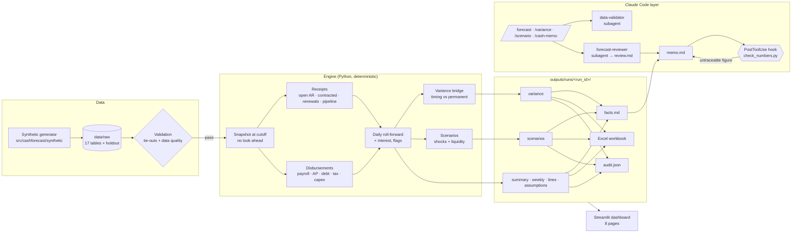

# Architecture

The design rests on one rule: **Python computes, Claude explains.** Every number comes
from deterministic code; Claude orchestrates the cycle, interprets results, translates
questions into engine inputs, and writes the narrative, under a hook that blocks any figure
it can't trace.

## Components

| Layer | Location | Responsibility |
|---|---|---|
| Synthetic data | `src/cashforecast/synthetic/` | Northwind Cloud simulation, anomaly injection, history/holdout split |
| Data checks | `src/cashforecast/data/` | Schemas, tie-outs, data-quality findings, holdout timeline |
| Engine | `src/cashforecast/engine/` | Snapshot, receipts, disbursements, roll-forward, variance, scenarios |
| Backtest | `src/cashforecast/backtest/` | Walk-forward accuracy vs naive baseline |
| Outputs | `src/cashforecast/outputs/` | Artifacts, facts sheet, workbook, traceability, audit |
| Entry points | `scripts/` | One script per job; `run_weekly.py` runs the deterministic cycle |
| Claude Code | `CLAUDE.md`, `.claude/` | Rules, skills, subagents, commands, the traceability hook |
| Dashboard | `app/` | Read-only views over run artifacts, plus live what-ifs |
| Evals | `tests/evals/` | Headless Claude Code runs graded by deterministic checks |

## Design decisions

**Snapshot at cutoff.** The live forecast and every backtest cutoff go through the same
`take_snapshot`, which rebuilds invoice status, contract churn and capex actuals as they
were known at that date. Look-ahead is impossible by construction, and tested.

**Every number has a source.** Each forecast line carries `source_type`, `source_id` and a
`note` naming the rule that produced it. The dashboard's drill-down and the reviewer
subagent both use this.

**Permanent means "no longer expected," not "past the horizon."** The variance split
compares both forecasts over a window 13 weeks beyond the horizon, so a renewal whose
invoice keeps slipping is timing, not permanent. See `methodology.md`.

**Traceability over trust.** Claude cites figures from `facts.md`; the hook re-checks every
`$` and `%` against the run's artifacts at the precision written. It reliably blocks
invented figures. It cannot prove a real figure is used in the right context (a value can
coincidentally round to an artifact number), which is why the reviewer subagent and the
evals check content as well.

**Evals grade behavior, not prose.** Each case runs Claude Code headless in a throwaway copy
of the repo and grades files and replies deterministically: memo traces, names the right
drivers, refuses bad data, leaves raw data untouched.

**Audit trail.** `audit.json` records code commit (and whether code or config had
uncommitted changes), config and data fingerprints, the data seed, step timings and a hash
of every artifact, so any memo can be tied to its exact inputs.
